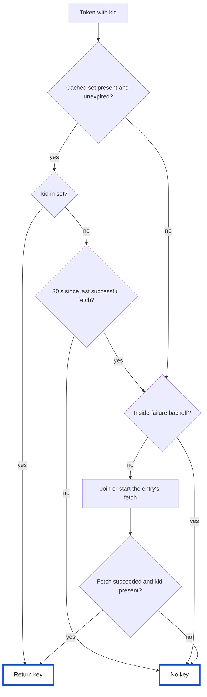

# Per-IdP JWKS cache timeout

Engineering plan for an optional JWKS cache timeout on the client IdP registry
record, and for the registry JWKS path changes the timeout depends on.

Ticket: TT-_____ (to add, with its acceptance criteria). This document
replaces the earlier draft at `.vscode/idp-jwks-cache-timeout.md`. Line
references are against `master` at `310d97be2` for `tyk`.

## Problem

JWKS URIs resolved through the client IdP registry always cache on the
gateway-level default, `JWKS.Cache.Timeout`, or 240 seconds when unset
(`gateway/server.go:110`, `buildJWKSCache` at `:2683`). JWKS URIs configured on
an API definition accept a per-URI `cache_timeout`. Key-rotation cadence is a
property of the IdP, so the registry record needs the same control.

Two properties of the current registry path shape the design. Registry-resolved
key sets are stored in the per-API cache (`gateway/mw_jwt.go:452`), so one IdP
bound to twenty APIs is fetched twenty times per node and expires on twenty
clocks. And no JWKS path re-fetches when a token carries a `kid` that the cached
set lacks, so an IdP that rotates without an overlap window fails every token
until the entry expires.

## Scope

In scope:

- the `jwks_cache_timeout` field on the record, end to end through the
  gateway, Dashboard, MDCB, Tyk Sync and Portal
- one JWKS entry per registry record in the gateway, replacing the per-API
  cache for registry keys
- a re-fetch on an unknown `kid`, behind a cooldown
- refresh before expiry for records with traffic
- failure backoff with jitter and a shared, bounded fetch client for the
  registry path
- a flush for registry entries, separate from the per-API one: gateway routes,
  a Dashboard route, a cluster notification and its MDCB fan-out
- fetch metrics
- org scoping of the gateway's client IdP registry (see Prerequisite)
- a warning for records bound to APIs that configure their own JWKS
- a fix for the per-URI prefetch marker

Out of scope: deprecating the per-URI field, honouring `Cache-Control`, serving
stale keys during an IdP outage, an asynchronous warm of registry entries, and
several JWKS URIs per record. Serving stale keys is designed for and listed under
Deferred.

## Decisions

| Decision | Choice | Basis |
|---|---|---|
| Field name | `jwks_cache_timeout` | Unambiguous on a record that also carries `api_mappings` and `scope_claim_name`. The registry endpoint is GA since v5.14.0, so the name is final on first ship |
| Registry identity | Each binding holds its record; a record binds only APIs of its own org | Records from different orgs collide in the direct-mode registry today (see Prerequisite) |
| Cache ownership | One entry per registry record | `jwks_uri` is not unique within an org (`tyk-analytics dashboard/model/clientidp.go:12-13`), so a URL-keyed entry would let one record set another's TTL |
| Minimum TTL | 10 s | Keycloak's minimum interval between key fetches; bounds IdP traffic and connection churn; equals the shortest TTL T5 already uses |
| Rotation | Re-fetch on unknown `kid`, 30 s cooldown | OIDC Core 1.0 section 10.1.1, Entra, Auth0, Cognito, Azure APIM, Keycloak, Kong and panva `jose` all do this |
| Out-of-band flush | Dedicated gateway and Dashboard routes plus an `InvalidateJWKSCacheForClientIdP` notification; per-API routes unchanged | The two caches are separate stores, so each gets its own control and no existing route changes meaning |
| Failure backoff | `cenkalti/backoff/v4` exponential: 1 s initial, ×1.5, ±50 % jitter, 30 s cap | Already a dependency; jitter keeps gateways that failed together from retrying together |
| Asynchronous warm | Removed | `rebuild` runs on every `DoReload` (`gateway/server.go:1355-1362`), and the only measured benefit came from the prefetch marker defect this plan fixes |
| `Cache-Control` | Not honoured | No gateway surveyed reads it natively; published `max-age` values range from 15 s (Auth0) to about 38 days (Okta) |
| Trust boundary | The gateway applies the floor and parses the value itself | MDCB, Sync and direct database writes reach the feed without Dashboard validation |
| Several URIs per record | No | Several records bound to one API already give several key sources; binding resolution walks every binding (`gateway/mw_jwt.go:395-402`) |

## Delivery

One PR per component.

| # | Repository | Change | Depends on |
|---|---|---|---|
| 1 | tyk | Registry org scoping, prefetch marker, field, JWKS entries, fetch client, `kid` re-fetch, backoff, flush routes and notification handling, metrics | nothing |
| 2 | tyk-analytics | Field, validation, absent-field rule on update, `api_mappings` org check, flush route and notification, swagger | nothing |
| 3 | tyk-sink | Field, flush fan-out, JSON field-name assertion | 2 |
| 4 | tyk-sync-internal | Field | 2 |
| 5 | portal | Parameter-struct refactor, then the field, as two commits | 2 |
| 6 | tyk-docs | Record field, TTL guidance, rotation behaviour, flush routes, the three precedence rules and why configuring both sources on one API is unsupported | 1, 2 |

PRs 1 and 2 together meet the acceptance criteria and can merge in either
order: an older gateway ignores the field and the notification, and a newer
gateway treats an absent field as unset. PRs 1 and 2 also carry the org-scoping
fix, so their descriptions show the defect; agree the timing with the security
process before opening them.

---

## Prerequisite: org scoping of the client IdP registry

Found during this review and fixed in the gateway and Dashboard PRs. The JWKS
entries depend on the fix because they attach to the registry's records, and
the registry's notion of record identity is what is wrong. Ticket: TT-_____.

### Defect

The Dashboard scopes client IdPs by org. `client_idp_id` is unique per
`(org_id, client_idp_id)` (`tyk-analytics dashboard/model/clientidp.go:12-13`),
change notifications carry both values, and MDCB loads one org's records and
APIs per edge (`tyk-sink storage/reload_listener.go:1010-1022`,
`LoadClientIdPs(orgID)`). The gateway registry in direct Dashboard mode does
not. `GetLiveClientIdPs` returns every org's records (`ListAll`, an unfiltered
query, `dashboard/service_loader.go:468-478`), and `rebuild` never reads
`OrgID` (`gateway/idp_registry.go:107-139`). Two cases follow. Both were
reproduced with unit tests against `rebuild`.

Two orgs holding the same `client_idp_id`, each bound to its own API: both APIs
resolve to whichever record comes later in the feed, because `idpsByID` and
`Binding.IdPID` use the ID alone. The default ID is the record's ObjectID hex
and the Portal never sets one. A duplicate comes from an API caller or from Tyk
Sync, which keeps `client_idp_id` on publish, so promoting one dump into two
orgs on the same Dashboard produces it. When the two records differ, for
example a staging and a production realm, one org's APIs resolve against the
other org's issuer, JWKS and scope claim.

A record whose `api_mappings` names an API owned by another org: the gateway
binds it, because `rebuild` checks only that the API is loaded on the node. The
Dashboard accepts the mapping, since `UpsertMapping` writes any `apiID`
(`dashboard/repository/clientidp/clientidp.go`) and `Create` and `Update` do not
check mapping keys.

MDCB edges are affected by neither case. Filtering the direct feed by org is
not an option, because one direct-mode gateway can serve several orgs.

### Gateway fix

The gateway is the only component every feed passes through (Dashboard, MDCB,
Sync, direct database writes), so it enforces the rule: a record binds only APIs
of its own org, and each binding holds a pointer to its record.

```go
type Binding struct {
	IdP           *IdP
	ScopeToPolicy map[string]string
}

// client_idp_id is unique only within an org.
type idpKey struct{ OrgID, ID string }
```

Three things leave the registry. `Binding.ScopeClaimName` was copied from the
record so the request path could skip a second lookup; the pointer makes the
copy redundant, and its one reader (`gateway/mw_jwt.go:1204`) reads
`binding.IdP.ScopeClaimName`. `idpsByID` and `IdP()` go too, because
`keyForBinding` (`gateway/mw_jwt.go:422`) is their only caller outside tests.

`rebuild` fills a builder that is local to the call and indexes one record at a
time:

```go
// snapshotBuilder is local to one rebuild call and never shared.
type snapshotBuilder struct {
	orgByAPI      map[string]string
	bindingsByAPI map[string][]Binding
}

func (b *snapshotBuilder) add(idp *IdP) {
	var rec *IdP
	for apiID, sm := range idp.APIMappings {
		org, loaded := b.orgByAPI[apiID]
		if !loaded {
			continue
		}
		if org != idp.OrgID {
			idpLog(idp).WithFields(logrus.Fields{"api_id": apiID, "api_org_id": org}).
				Warn("Ignoring client IdP mapping to an API in another org")
			continue
		}
		if rec == nil { // copy on first binding, so unbound records are not retained
			c := *idp
			rec = &c
		}
		b.bindingsByAPI[apiID] = append(b.bindingsByAPI[apiID], Binding{IdP: rec, ScopeToPolicy: sm.ScopeToPolicy})
	}
}

func (gw *Gateway) loadedAPIOrgs() map[string]string {
	gw.apisMu.RLock()
	defer gw.apisMu.RUnlock()
	orgs := make(map[string]string, len(gw.apisByID))
	for id, spec := range gw.apisByID {
		orgs[id] = spec.OrgID
	}
	return orgs
}
```

`rebuild` skips `loadedAPIOrgs` when the feed is empty, so file mode and
deployments without IdPs never read the loaded APIs. Rejected mappings are
logged at warn on every rebuild, the way API loading logs an invalid spec on
each reload (`gateway/api_loader.go:198`).

`keyForBinding` reads the record from the binding:

```go
func (k *JWTMiddleware) keyForBinding(b Binding, iss, kid string) any {
	if iss != "" && b.IdP.Issuer != iss {
		return nil
	}
	return k.fetchJWKSKey(b.IdP.JWKSURI, kid)
}
```

The loop in `add` runs over one record's mappings and `rebuild` calls `add` once
per record, so a rebuild visits each mapping once with constant-time map
lookups: linear in the number of mappings. Iterating `idps` by index avoids the
per-record struct copy the current `for _, idp := range idps` loop makes.

### Dashboard fix

`Create`, `Update`, `UpsertMapping` and `MergeMappings` reject an
`api_mappings` key that is not an API in the caller's org, with 400 through
`handlers.HandleError`. The gateway check stays the enforcement point, because
MDCB, Sync and direct database writes bypass the Dashboard. The Dashboard check
gives the author an error instead of a mapping the gateway ignores.

### Behaviour change

After the gateway change, existing cross-org mappings stop binding, and each is
logged as a warning on every rebuild. A record with an empty `OrgID` binds only APIs
whose org is also empty. Operators can find affected records from the warning
before and after upgrading.

### Performance

The request path gets cheaper. Today `keyForBinding` takes the registry read
lock and does a map lookup per binding; after the change it follows a pointer.

`rebuild` stays linear in the number of mappings. `loadedAPIOrgs` is the same
loop over loaded APIs under the same brief read lock as today's snapshot of
loaded API IDs, with one extra field read per API and 16 more bytes per entry in
a map discarded after the rebuild. Each mapping adds one string comparison.

Memory matches today. Each bound record is copied once and shared by its
bindings; pointing into the fetched slice instead would keep unbound records
from other segments and orgs alive. `Binding` drops the 16-byte `IdPID` and
`ScopeClaimName` strings and gains an 8-byte pointer, 24 bytes less per
binding.

### Tests

- two orgs with the same `client_idp_id`, each bound to its own API: each API
  resolves to its own org's record
- a record mapping an API in another org: no binding and one warning
- the 14 references to `Binding.IdPID` and `IdP()` in
  `gateway/idp_registry_test.go` move to `Binding.IdP`, and assertions on
  `Binding.ScopeClaimName` move to `Binding.IdP.ScopeClaimName`
- the fixtures that build `APISpec{}` without an `APIDefinition` gain one
  through a test helper, since `loadedAPIOrgs` reads the org; records without
  `OrgID` keep binding APIs whose org is also empty. `rebuild` returns before
  the snapshot when the feed is empty, so file mode and deployments without
  IdPs never read the loaded APIs
- Dashboard: create, update, mapping upsert and merge with another org's API ID
  return 400
- a parallel benchmark of `secretFromIdPRegistry` before and after

---

## Gateway (`tyk`)

### Code conventions

New code uses `any`. `go.mod` targets Go 1.26, `internal/cache/cache.go`
already uses `any`, and `gateway/mw_jwt.go` mixes both spellings (32
`interface{}`, 8 `any`) with no linter enforcing either. The two are the same
type, so functions these PRs touch switch to `any` in their signatures, and the
rest of the package is left to a separate mechanical change
(`gofmt -r 'interface{} -> any'`). The JWKS types go in a new file,
`gateway/idp_jwks.go`, rather than growing `mw_jwt.go`.

### Per-URI prefetch marker

`JWTMiddleware.Init` (`gateway/mw_jwt.go:74-110`) prefetches every
`JWTJwksURIs` entry into the per-API cache with `jwkCache.Set(jwk.URL, ...)`
(`:106`) and never writes the `JWKsAPIDef` marker. The first request then
reaches `getSecretFromMultipleJWKURIs` with `foundDef == false` (`:579`), calls
`jwkCache.Flush()` (`:596`) and fetches every URI again. T5 measured this as one
wasted upstream fetch per API reload, in two independent phases.

The fix writes the marker in `Init` once at least one set is cached, as the
request path does at `:628`:

```go
		if cached > 0 {
			jwkCache.Set(k.specCacheKey(k.Spec, JWKsAPIDef), k.Spec.APIDefinition, cache.DefaultExpiration)
		}
```

`Init` and the request path share one per-API cache instance
(`loadOrCreateJWKCache`, `:128-130`). A request that arrives before the
prefetch completes still takes the flush branch and fetches, which is today's
behaviour. The T5 measurement used `v5.14.0-alpha1` images and is repeated on
`master` before merge.

### Record field

`gateway/idp_registry.go`, on `IdP`:

```go
	// Shorthand duration ("2m30s"); empty selects the gateway default.
	JWKSCacheTimeout string `json:"jwks_cache_timeout"`
```

The field is a `string`, as on every other component, rather than
`tyktime.ReadableDuration`. `ReadableDuration` turns an unparseable string into
zero without a trace; parsing in `rebuild` lets the gateway log which record
fell back to the default. Neither type protects the feed from a non-string JSON
value, because `encoding/json` also reports a type mismatch on a `string` field
and `unmarshalIdPs` (`:300-319`) fails the whole refresh on any error. Both
producers of the feed, the Dashboard and MDCB, marshal a Go `string`, so the
case does not arise from them.

```go
const jwksMinTTL = 10 * time.Second

type ttlSource string

const (
	ttlFromRecord  ttlSource = "record"
	ttlFromDefault ttlSource = "default"
	ttlFromFloor   ttlSource = "floor"
)

// An invalid value yields the default TTL together with a non-nil err.
func (i IdP) jwksTTL(gwDefault time.Duration) (ttl time.Duration, source ttlSource, err error) {
	ttl, source = gwDefault, ttlFromDefault
	if i.JWKSCacheTimeout != "" {
		d, perr := time.ParseDuration(i.JWKSCacheTimeout)
		if perr == nil && d > 0 {
			ttl, source = d, ttlFromRecord
		} else {
			err = fmt.Errorf("invalid jwks_cache_timeout %q, using the gateway default", i.JWKSCacheTimeout)
		}
	}
	if ttl < jwksMinTTL {
		ttl, source = jwksMinTTL, ttlFromFloor
	}
	return ttl, source, err
}
```

`gwDefault` uses the expression in `buildJWKSCache`: `JWKS.Cache.Timeout`
seconds when positive, else 240 s. The floor applies to every registry entry,
including one on a gateway default below 10 s. The per-URI field keeps today's
behaviour and gains only a warning log for values below 10 s, because raising
them would change existing API definitions.

### JWKS entries on the registry

Each record in the registry snapshot owns one `jwksEntry`. The entry holds the
cached key set, its expiry and the state of any fetch in progress. It has no
knowledge of IdPs, so the per-URI path can hold one entry per URI if it moves
onto this type later.

```go
type jwksEntry struct {
	url string
	ttl time.Duration

	cached      atomic.Pointer[cachedJWKS]
	lastSuccess atomic.Int64 // unix ns; atomic so the unknown-kid path takes no lock

	mu         sync.Mutex
	gen        uint64 // a fetch stores its result only if gen is unchanged
	inflight   *jwksFetch
	retryAfter time.Time
	backoff    *backoff.ExponentialBackOff
}

func newJWKSEntry(url string, ttl time.Duration) *jwksEntry {
	return &jwksEntry{url: url, ttl: ttl, backoff: backoff.NewExponentialBackOff(
		backoff.WithInitialInterval(time.Second),
		backoff.WithMaxInterval(30*time.Second),
		backoff.WithMaxElapsedTime(0), // keep retrying while requests arrive
	)}
}

type cachedJWKS struct {
	keys    map[string]any
	expires time.Time
}

type jwksFetch struct {
	done chan struct{}
	keys map[string]any
	err  error
}
```

`lastSuccess` is atomic because the unknown-`kid` path is the one an
unauthenticated caller controls: a flood of tokens with made-up `kid` values
checks the cooldown with one atomic load and takes no lock.

`cachedJWKS` indexes keys by `kid` when it is stored. The current lookup,
`jose.JSONWebKeySet.Key`, scans the set and allocates a result slice on every
request. The index keeps the first key per `kid`, matching `keyFromJWKSet`,
which returns `keys[0]`.

`IdPRegistry` gains `jwksByIdP map[idpKey]*jwksEntry`, swapped under the same
lock as `bindingsByAPI`, and a `jwksFetcher`. `Binding` gains `JWKS *jwksEntry`,
set to the same entry for every binding of a record. The `Gateway` struct gains
no cache field. The builder carries entries across rebuilds:

```go
type snapshotBuilder struct {
	orgByAPI      map[string]string
	bindingsByAPI map[string][]Binding

	gwDefault time.Duration
	prevJWKS  map[idpKey]*jwksEntry
	jwksByIdP map[idpKey]*jwksEntry
}
```

In `add`, the first binding of a record also resolves its entry, and every
binding of the record carries it:

```go
		if rec == nil {
			c := *idp
			rec = &c
			entry = b.jwksEntryFor(rec)
		}
		b.bindingsByAPI[apiID] = append(b.bindingsByAPI[apiID], Binding{IdP: rec, JWKS: entry, ScopeToPolicy: sm.ScopeToPolicy})
```

```go
// Returns nil for a record without a usable HTTP(S) jwks_uri.
func (b *snapshotBuilder) jwksEntryFor(idp *IdP) *jwksEntry {
	// Private hosts stay allowed (an internal Keycloak is normal); other schemes do not.
	if !httpScheme.MatchString(idp.JWKSURI) {
		idpLog(idp).Warn("Client IdP has no usable HTTP(S) jwks_uri; its tokens cannot be verified")
		return nil
	}
	ttl, source, err := idp.jwksTTL(b.gwDefault)
	if err != nil {
		idpLog(idp).WithError(err).Warn("Client IdP JWKS cache timeout")
	}

	key := idpKey{idp.OrgID, idp.ID}
	entry, carried := b.prevJWKS[key]
	if !carried || entry.url != idp.JWKSURI || entry.ttl != ttl {
		entry = newJWKSEntry(idp.JWKSURI, ttl)
		idpLog(idp).WithFields(logrus.Fields{"ttl": ttl, "source": source}).Debug("Client IdP JWKS entry created")
	}
	b.jwksByIdP[key] = entry
	return entry
}
```

`rebuild` reads `prevJWKS` under the registry's read lock and `gwDefault` from
the gateway config, and swaps `b.jwksByIdP` in with `b.bindingsByAPI`. A bad
`jwks_uri` or timeout is logged at warn on every rebuild, like a rejected
mapping.

Reading `r.jwksByIdP` before the swap is safe because `doRefresh` holds
`refreshMu` (`:169-172`), so no other rebuild runs concurrently. Keying entries
by `idpKey` means two orgs sharing a `client_idp_id` never share an entry.

An entry survives a rebuild only when its URL and TTL are unchanged. A changed
record gets a fresh entry, which is the whole of invalidation: a fetch still in
progress on the old entry stores its result where no request reads it.
`invalidateChangedJWKS`, the `LastUpdated` field and the org-scoped cache key
from the earlier draft are not needed. A record dropped from the snapshot, for
example because its last bound API was deleted, loses its entry and starts cold
if it returns. The debug line logged when an entry is created tells an
operator whether its TTL came from the record, the default or the floor, which
separates "an older MDCB stripped the field" from "not configured".

### Lookup path



`keyForBinding` reads the record and its entry from the binding, with no
registry lookup, and passes the request context down. `secretFromIdPRegistry`
already holds the request and passes it in:

```go
func (k *JWTMiddleware) keyForBinding(r *http.Request, b Binding, iss, kid string) any {
	if b.JWKS == nil || (iss != "" && b.IdP.Issuer != iss) {
		return nil
	}
	return b.JWKS.key(r.Context(), k.Gw.idpRegistry.fetcher, kid)
}
```

`fetchJWKSKey`, `fetchAndCacheJWKS`, `jwksFetchGroup` and the per-request scheme
check are removed from the registry path. The per-URI paths do not use them.

```go
func (e *jwksEntry) key(ctx context.Context, f *jwksFetcher, kid string) any {
	now := time.Now()
	if c := e.cached.Load(); c != nil && now.Before(c.expires) {
		if key, ok := c.keys[kid]; ok {
			return key
		}
		if now.UnixNano()-e.lastSuccess.Load() < int64(jwksKidMissCooldown) {
			return nil
		}
	}
	keys, err := e.fetch(ctx, f)
	if err != nil {
		return nil
	}
	return keys[kid]
}

func (e *jwksEntry) fetch(ctx context.Context, f *jwksFetcher) (map[string]any, error) {
	e.mu.Lock()
	if time.Now().Before(e.retryAfter) {
		e.mu.Unlock()
		return nil, errJWKSBackoff
	}
	fl := e.inflight
	if fl == nil {
		fl = &jwksFetch{done: make(chan struct{})}
		e.inflight = fl
		go e.run(f, fl, e.gen)
	}
	e.mu.Unlock()

	select {
	case <-fl.done:
		return fl.keys, fl.err
	case <-ctx.Done():
		return nil, ctx.Err()
	}
}

func (e *jwksEntry) run(f *jwksFetcher, fl *jwksFetch, gen uint64) {
	keys, err := f.fetch(e.url)
	now := time.Now()

	e.mu.Lock()
	switch {
	case err != nil:
		e.retryAfter = now.Add(e.backoff.NextBackOff())
	case e.gen == gen:
		e.cached.Store(&cachedJWKS{keys: keys, expires: now.Add(e.ttl)})
		e.lastSuccess.Store(now.UnixNano())
		e.backoff.Reset()
		e.retryAfter = time.Time{}
	}
	e.inflight = nil
	e.mu.Unlock()

	fl.keys, fl.err = keys, err
	close(fl.done)
}

// Bumping gen stops a fetch already in flight from storing its result.
func (e *jwksEntry) flush() {
	e.mu.Lock()
	e.gen++
	e.cached.Store(nil)
	e.lastSuccess.Store(0)
	e.mu.Unlock()
}
```

The fetch runs in its own goroutine, detached from any request, so a request
that gives up does not cancel the fetch for the others. The client timeout
bounds it. Requests that joined the fetch before a flush still receive its
result for their own lookup; the result is not stored.

### Rotation on an unknown `kid`

A lookup that finds the set but not the `kid` re-fetches if the last successful
fetch is at least 30 s old. Inside that window it returns no key without an
error, as panva `jose` does. Nimbus throws instead, which turns a burst of
unknown `kid` values into failures for valid tokens in the same window.

The cooldown is measured from the last success, so tokens with made-up `kid`
values cause at most two fetches per minute per entry per node, on top of
fetches at expiry. A flush resets the cooldown so the next unknown `kid`
fetches at once.

Rotation then works without operator action whenever the IdP signs with a key
it has already published, and within 30 s when it signs with a key it publishes
at the same moment. The per-URI paths keep today's behaviour.

### Failure handling

A failed fetch starts a backoff from `cenkalti/backoff/v4`, the library the
gateway already uses for RPC and storage reconnects: 1 s initial, ×1.5 on each
further failure, ±50 % jitter, capped at 30 s, reset on success. The jitter
matters across nodes: gateways that saw the IdP fail at the same moment spread
their retries instead of arriving together. During the backoff, lookups return
no key at once. Today every request after a failure starts another fetch, so the
IdP receives the most traffic when it is failing.

`ExponentialBackOff` is not safe for concurrent use; the entry only touches it
under `mu`.

An expired set is not served during the backoff; the registry path fails closed
as it does today, only faster. Deferred covers serving stale keys.

The legacy x5c fallback parses the bytes of the same response when the
`go-jose` parse fails, reusing the decoding in `legacyGetSecretFromURL`
(`:156`). Today the fallback issues a second GET per waiting request, outside
the single-flight, and caches its result in the per-API cache on the default
TTL. After this change one fetch yields at most one legacy parse, and the
result is stored on the entry with the record's TTL. A network error does not
trigger the fallback.

### Fetch client

`jwksFetcher` builds one `*http.Client` on first use and reuses it:

- `CreateJWKClient` from the external HTTP client factory when external
  services are configured for OAuth or globally
- otherwise a client with `Timeout` 15 s (the factory's OAuth value), a
  `Transport` with `IdleConnTimeout` 30 s and `TLSHandshakeTimeout` 10 s, and
  `InsecureSkipVerify` from `JWTSSLInsecureSkipVerify`

The response body is read through `io.LimitReader` with a 1 MiB cap (Nimbus
uses 50 KB).

Both current paths build a new `Transport` per fetch, the factory at
`internal/httpclient/factory.go:411` and `getJWK` at `gateway/mw_jwt.go:1759-1766`,
so no connection is reused and every fetch pays a TCP and TLS handshake. The
factory returns an error unless external services are configured
(`isServiceConfigured`, `factory.go:179`), so default installations take the
`getJWK` path. Its zero-value `Transport` has no `IdleConnTimeout`, which keeps
every idle keep-alive connection and its two goroutines open until the IdP
closes it, and its `http.Client` has no timeout, so an IdP that accepts and
never answers holds every waiting request indefinitely.

### Flush routes

The registry cache gets its own controls. The per-API routes keep acting on the
per-API cache only.

| Scope | This gateway | Every gateway |
|---|---|---|
| One record | `DELETE /tyk/clientidps/{orgID}/{idpID}/jwks-cache` | Dashboard `DELETE /api/clientidps/{id}/jwks-cache` |
| All records | `DELETE /tyk/clientidps/jwks-cache` | none |

The Dashboard route publishes `InvalidateJWKSCacheForClientIdP` with the
`{"org_id","client_idp_id"}` payload `ClientIdPChanged` already uses.
Direct-mode gateways handle it from Redis. MDCB turns it into a
`<client_idp_id>:InvalidateJWKSCacheForClientIdP` keyspace event for the org's
groups, and edges take the org from the keyspace batch it arrives in. The
gateway rejoins everything before the last `:` into the ID, because
`client_idp_id` is caller-supplied and may contain one.

The gateway routes sit under `/tyk/clientidps/` rather than `/tyk/cache/`,
because the existing `/tyk/cache/{apiID}` pattern matches any single segment
under `/tyk/cache/`. All the routes return 200 whether or not the record is
bound on the node, as the per-API routes do.

Registry-resolved keys live in the per-API cache today, so
`DELETE /api/cache/jwks/:apiId` currently clears them too. After this change it
does not, and the release notes point at the record route.

### Observability

Three instruments in `MetricInstruments` (`internal/otel/metrics_instrument.go`),
next to `exchangeRequests` and `exchangeDuration`:

- `tyk.jwt.jwks.fetches`, a counter with `source` (`registry`) and `outcome`
  (`ok`, `error`, `legacy`)
- `tyk.jwt.jwks.fetch.duration`, a histogram with the same attributes
- `tyk.jwt.jwks.kid_miss`, a counter with `result` (`refetched`, `cooldown`)

Attributes carry no IdP or org identifiers, to keep series count independent
of tenant count. The `source` attribute leaves room for the per-URI path.
Fetch errors keep logging through `logJWKError`, once per failed fetch rather
than once per waiting request.

### Precedence

Unchanged. `getSecretToVerifySignature` (`:321`) returns from the OAS
`JWTJwksURIs` branch (`:325-327`) and the `JWTSource` branch (`:330-349`) before
calling `secretFromIdPRegistry` (`:367`). Explicit API configuration wins and the
registry is the fallback, which is the order a migration needs: an operator
moves an IdP into the registry, removes the API-definition URIs, and at no point
does neither source resolve. The two paths keep separate stores, so each keeps
its own TTL.

When an API carries both, the API's own configuration decides everything and
the record contributes nothing to that API:

- The per-URI `cacheTimeout` governs. The record's `jwks_cache_timeout` is not
  consulted, and its JWKS is never fetched on this API's behalf, so the entry
  stays empty and costs nothing.
- The binding contributes nothing either. `ctxSetMatchedBinding` is only reached
  inside `secretFromIdPRegistry` (`:409`), so the record's `scope_to_policy` and
  `scope_claim_name` never apply to that request. An operator who expects the
  record's scope mapping to merge with a manually configured API gets neither
  that mapping nor a warning.
- The record keeps working normally for the other APIs bound to it, from one
  shared entry on its own TTL.
- The same URL configured on both sides is fetched once per store, so the two
  caches each hold their own copy on their own timeout.

Merging is also the odd one out in the codebase: `GetScopeToPolicyMapping`
(`apidef/api_definitions.go:1795`) selects the OIDC or the JWT mapping rather
than merging them. The merge stays, because a conflict always resolves to the
API's value and removing it would break anyone relying on it, but it is an
inconsistency worth knowing when the next layer of configuration is added.

The three settings do not follow one rule, which is worth stating plainly.
The signing key is exclusive: the first source that resolves wins and the other
is never consulted. The scope claim name falls back: manual configuration, then
the matched record, then `scope`. The scope map merges: `scopeToPolicyMapForRequest`
(`gateway/idp_registry.go:282`) starts from the binding's mapping and lets the
API's own entries overwrite it, so manual wins per scope name and the record
fills the scopes the API does not define. The merge only runs when a binding was
matched, so it is the key-resolution path, not the configuration, that decides
whether a record's scope map applies at all.

That coupling is deliberate and this plan keeps it. The binding is selected
while the key is resolved and read after the token verifies
(`gateway/mw_jwt.go:1256`), so the record that governs a request is the one
whose JWKS verified it. Selecting a record without resolving its key would mean
choosing by the token's `iss` claim before verification, and with several
records bound to one API there is no unambiguous choice at all. The warning
below covers the case instead.

One asymmetry is worth knowing: `JWTJwksURIs` is honoured only when `IsOAS` is
set (`:325`). A classic API carrying that list falls through to `JWTSource`, and
with no source set it reaches the registry, so there the record does govern.

Nothing warns about an API that has both today, so the gateway PR adds one: the
loaded-API snapshot already reads each spec, so it also records whether the spec
sets `jwksURIs` or `JWTSource`, and `rebuild` logs each record bound to such an
API at warn, saying the binding resolves no keys and its scope mapping does not
apply. Configuring both stays unsupported rather than silently ignored.

### Concurrency and performance

What is shared, and how:

- `snapshotBuilder` is a local value of one `rebuild` call. It is built, filled
  and dropped on one goroutine and never escapes, so it needs no lock, the same
  as any local map.
- `rebuild` itself never runs concurrently: its only caller, `doRefresh`, holds
  `refreshMu`.
- The published maps (`bindingsByAPI`, `jwksByIdP`) and the records they point
  at are swapped in under `r.mu` and never modified afterwards. Readers take
  `r.mu.RLock` only to read the map header.
- A `jwksEntry` protects itself: the cached set and `lastSuccess` are atomics,
  everything else is guarded by the entry's mutex.

What the design guarantees:

- A cache hit takes the registry read lock once, to read the API's bindings, and
  one atomic load per binding. It allocates nothing and builds no key string.
- One fetch runs per entry at a time. Waiting requests leave when their context
  ends, and the fetch itself is bounded by the client timeout.
- A record edited or flushed during a fetch never receives that fetch's result:
  an edit replaces the entry, and a flush bumps the generation the store checks.
- Unknown `kid` values cause at most one fetch per 30 s per entry per node, and
  the cooldown check is one atomic load, so a flood of forged tokens takes no
  lock. A failing IdP receives at most one fetch per backoff interval per entry
  per node.

`TestIdPRegistry_ConcurrentUse` runs rebuilds, lookups, fetches and both kinds
of flush against each other for 2 s; it passes under `-race` across repeated
runs.

Fetch rate to an IdP, per record, is the number of nodes divided by the TTL:
fifty nodes on the 10 s floor send five requests per second, and on the 240 s
default about one every five seconds. On the cache-hit path a benchmark gives
about 36 ns and no allocation, against 170 ns and one allocation before.

### Session lookup on the registry path

A registry-resolved request first checks for a Tyk key whose ID is the token's
`kid`, because such a key takes precedence over the registry. On a miss,
`CheckSessionAndIdentityForValidKey` (`gateway/middleware.go`) asked the global
session store and then the API's auth store with the same query. The two
usually read the same keys: both are `RedisCluster` handlers with the `apikey-`
prefix on the gateway's one Redis connection. They are rarely the same object,
because a reload builds a new store for the global session manager while
unchanged APIs keep the one they were loaded with.

`sameKeyStore` compares what the two stores read (connection, prefix, hashing,
cache and analytics flags) and skips the second query when they match. LDAP- and
RPC-backed auth stores still get their lookup. The outcome is unchanged; the
lookup that decides precedence still runs.

Measured on the e2e stack, Redis `MGET`s per registry request fell from two to
one. The remaining one is the precedence check itself, and only a change to
precedence could remove it. The change also halves the Redis round trips of
every other authentication miss that passes through this function.

### Refresh before expiry

A request that finds a record's key set in the last fifth of its timeout, capped
at 30 seconds, gets the cached key at once and starts a background refresh
through the entry's existing fetch, so it shares the one-fetch-per-entry rule and
the failure backoff. The fetch runs on a context derived from the gateway's, so
it stops at shutdown. A failed refresh leaves the cached set in use until its
normal expiry; serving it past expiry is a separate decision (below).

Only requests trigger a refresh, so a record without traffic is never fetched,
and refreshes stagger across nodes by themselves. With steady traffic the key set
is renewed at the start of the window instead of at expiry, so the IdP sees
slightly more fetches than today: at most 12.5 % more on the 240 second default
(a 30 second window), 5 % on 10 minutes, and 25 % on the 10 second floor. In
exchange, requests to an active record never wait on the IdP at expiry, which is
otherwise about 360 blocking fetches per record per node per day at the default.

A record requested less often than its timeout still fetches on nearly every
request; refresh before expiry cannot help traffic it never sees.

### Deferred

Serving stale keys keeps an expired set in use when a refresh fails. Background
refreshers do this (Envoy `async_fetch`, istiod for up to seven days, Kong,
Entra's "last known good" guidance), and Nimbus offers it as an option. The cost
is that a revoked key stays trusted for the outage window, which needs its own
security decision.

`cachedJWKS` keeps the expiry beside the set rather than deleting the set, so
this change is local to `key` and `run`.

---

## Dashboard (`tyk-analytics`)

### Model

`dashboard/model/clientidp.go`, on `ClientIdP`:

```go
	// Shorthand duration ("2m30s"), at least 10s; empty selects the gateway default.
	JWKSCacheTimeout string `bson:"jwks_cache_timeout" json:"jwks_cache_timeout" gorm:"column:jwks_cache_timeout"`
```

SQL creates the column through the auto-migrate list (`dashboard/sql_storage.go:27`);
Mongo needs no migration. Records written before the change read back empty.
The gateway feed marshals the model directly (`dashboard/service_loader.go:468-478`),
so it carries the field with no further change.

### Validation

`dashboard/handlers/clientidp/handler.go`, in `Create` and `Update` after the
existing `JWKSURI` check (`:76`, `:161`):

```go
const errMsgInvalidCacheTimeout = `jwks_cache_timeout must be a duration of at least 10s (e.g. "45s", "2m30s")`

		if !validJWKSCacheTimeout(idp.JWKSCacheTimeout) {
			handlers.HandleError(errMsgInvalidCacheTimeout, http.StatusBadRequest, w, h.instrument)
			return
		}
```

```go
func validJWKSCacheTimeout(v string) bool {
	if v == "" {
		return true
	}
	d, err := time.ParseDuration(v)
	return err == nil && d >= 10*time.Second
}
```

The check reports through `handlers.HandleError` like the other checks in the
file (`:72-79`, `:157-164`). An error routed through `h.handleServiceError`
falls through to 500 (`:357-376`).

### Absent field on update

`Update` decodes the body into a fresh `model.ClientIdP` (`:153-156`) and the
repository replaces the whole document (`dashboard/repository/clientidp/clientidp.go:191-228`).
A client built before the field existed sends no `jwks_cache_timeout` and would
clear it on every write. Older Tyk Sync (`tyk-sync-internal clients/dashboard/clientidp.go:250-261`)
and older Portal (`portal thirdparty/dashboard/clientidps.go:102-114`) both
write this way, and the delivery order puts them after the Dashboard.

`Update` therefore decodes the field a second time as `*string`. When the key
is absent, the handler copies `existing.JWKSCacheTimeout` onto the incoming
record before persisting. An explicit `""` clears the value. This makes one
field an exception to whole-document replace. The alternative, requiring Sync
and Portal to be upgraded before anyone sets the field, leaves a silent
data-loss path for any client that lags.

### JWKS flush route

`DELETE /api/clientidps/{id}/jwks-cache` looks the record up in the caller's
org (404 if absent) and publishes `InvalidateJWKSCacheForClientIdP` with the
record's org and `client_idp_id`. It is not gated by `NotifyOnChange`: it is an
explicit operator action, like `DELETE /api/cache/jwks/:apiId`. The handler
takes the publisher as a `FlushFunc` beside the existing `NotifyFunc` and
returns 500 when the notification cannot be sent. The route inherits the
`/api/clientidps` permission (`apis:write` for DELETE).

### Spec and tests

`swagger.yml`: add `jwks_cache_timeout` to `ClientIdPRequest` (`:16653`) and
`ClientIdP` (`:16688`), documenting the format, the 10 s minimum, the fallback
to the gateway default, and that an update without the field keeps the stored
value; add the flush route beside the other `/api/clientidps/{id}` paths.

No repository change and no change to `Version` or `last_updated`.

---

## MDCB (`tyk-sink`)

`models/client_idp.go`, on `ClientIdP`:

```go
	JWKSCacheTimeout string `bson:"jwks_cache_timeout" json:"jwks_cache_timeout" gorm:"column:jwks_cache_timeout"`
```

`pruneIdP` shallow-copies the record before filtering `api_mappings`
(`storage/reload_listener.go:996`), so `GetClientIdPs` and `GetClientIdP` both
carry the field. MDCB only reads the table and gorm selects every column, so a
missing column reads back empty rather than failing. Add an assertion to
`TestClientIdP_JSONFieldNames` (`models/client_idp_test.go`), as the
`scope_claim_name` change did.

The record flush needs a fan-out case beside `NoticeInvalidateJWKSCacheForAPI`
(`storage/reload_listener.go:1273-1281`). The payload already carries the org,
so no `GetOrgForAPI` lookup is needed:

```go
	case NoticeInvalidateJWKSCacheForClientIdP:
		var p clientIdPChangedPayload
		if err := json.Unmarshal([]byte(thisMessage.Payload), &p); err != nil || p.OrgID == "" {
			log.Warning("Could not parse InvalidateJWKSCacheForClientIdP payload")
			return
		}
		setOrgKeySpaceEvent(p.OrgID, p.ClientIdPID+":"+string(NoticeInvalidateJWKSCacheForClientIdP))
		return
```

`setOrgKeySpaceEvent` is the body `setInvalidateJWKSCacheForAPIEventForClusters`
already has, taking the key: write it to every tracked group of the org with the
one-hour expiry. A test in `storage/reload_listener_test.go` asserts that the
notification writes `<client_idp_id>:InvalidateJWKSCacheForClientIdP` to each
tracked group of the payload's org, mirroring the per-API fan-out test.

The gateway stores the raw RPC payload for emergency mode
(`gateway/rpc_backup_handlers.go:207-208`), so the backup carries the field.

---

## Tyk Sync (`tyk-sync-internal`)

`clients/objects/clientidp.go`, on `ClientIdP`, without `omitempty`:

```go
	JWKSCacheTimeout string `bson:"jwks_cache_timeout" json:"jwks_cache_timeout"`
```

Dump marshals the whole struct into `clientidp-{id}.json` (`cmd/dump.go:611`,
`:616`) and publish sends the whole struct. A current Sync sends `""` to clear
the value; an older Sync omits the key and the Dashboard keeps the stored value.
Sync's own validation (`tyk-vcs/getter.go:433-441`) needs no change.

---

## Portal (`portal`)

Two commits in one PR.

The first replaces the positional identity arguments with one struct. With the
new field, `EnsureIDPRegistryForConfig` would take five consecutive `string`
arguments. The chain:

- the interface (`model/provider/iprovider.go:55`) and implementation
  (`model/tyk-pro/idp_config_reconcile.go:13`)
- `createIDPForConfig` (`:60`), `adoptExistingIDP` (`:103`),
  `reconcileExistingIDP` (`:33`)
- `newClientIDP` (`model/tyk-pro/idp_registry.go:65`) and its callers at
  `idp_registry.go:56` and `idp_config_reconcile.go:78`
- the mockery mock (`model/provider/testing/mock_provider.go`, regenerated), the
  hand-written `mockIProvider` (`config/application/application_test.go:944`)
  and `mock_provider_idp_test.go`

The second adds the field, following `ScopeClaimName`:

- `model/product/dcr.go:76`: `JWKSCacheTimeout string` with
  `gorm:"column:jwks_cache_timeout"` on `DCRConfig`; auto-migrate creates the
  column (`config/db/automigrate.go:63`)
- `thirdparty/objects/clientidp.go:45`: the field without `omitempty`, so
  clearing sends `""`. `ScopeClaimName` uses `omitempty`, and under the
  Dashboard's absent-field rule an omitted value would never clear
- `app/dcr/helpers.go`: a meta beside `scopeClaimNameMeta` (`:89-94`) and a row
  in `dcrSection1` (`:37`), labelled optional, with a tooltip giving the format,
  the 10 s minimum and the default
- `app/dcr/dcr.go:39`: register the meta with `dcrSettings.Meta(...)`; without
  it the row renders unbound
- `app/api/oauth.go:36-37`: add the field to `NewAttrs`, which `EditAttrs`,
  `IndexAttrs` and `ShowAttrs` inherit
- `app/api/oauth.go:223`: a validator in `getOauthProviderValidators` accepting
  empty or a duration of at least 10 s. `ScopeClaimName` has no validator, so
  this has no precedent in the file
- `app/dcr/registry.go`: `prepareSaveState` (`:187`) returns the previous value,
  `saveChangeSet` (`:201-207`) carries it, `registryRelevant` (`:236`) compares
  it, the call at `:243` passes it and the literal at `:274-279` fills it.
  Without the `registryRelevant` comparison, an edit to the timeout alone is
  never pushed
- `config/application/application.go:404`: pass the value in the upgrade
  backfill
- `model/tyk-pro/idp_registry_inbound.go:92-98`: copy the field when inbound
  sync creates a `DCRConfig`
- `docs/api/enterprise-developer-portal-swagger.yaml:8190`: the property on
  `OAuthProviderBasic`, which create, list and show inherit

`DCRResponse` (`model/product/dcr.go:112-113`) and the copies in
`model/client/dcr-helpers.go:230,392` carry `ScopeClaimName`, but production
never reads it from there. The new field is not added to them.

---

## Compatibility

| Gateway | Dashboard | Between them | Result |
|---|---|---|---|
| older | newer | direct | The gateway ignores the unknown field; default TTL |
| newer | older | direct | Field absent; default TTL, floored at 10 s |
| newer | newer | older MDCB | MDCB drops the field; the edge uses the default, and the rebuild log shows `source=default` |
| any | newer | older Sync or Portal writing | The Dashboard keeps the stored value |
| newer | any | value below 10 s from a path that skips validation | Raised to 10 s, logged as `source=floor` |
| newer | any | direct, existing mapping to another org's API | The mapping stops binding; a warning is logged on every rebuild |
| older | newer | direct | The gateway ignores `InvalidateJWKSCacheForClientIdP`; its entries expire on the TTL |
| newer | newer | older MDCB | MDCB does not forward the record flush; edge entries expire on the TTL |

## Parity with the per-URI field

| Property | Per-URI field (today) | Registry record |
|---|---|---|
| Format | `ReadableDuration` per URI | shorthand string per record, parsed by the gateway |
| Unset | gateway default | gateway default, raised to 10 s if lower |
| Below 10 s | accepted; sub-second truncates to unset | rejected by Dashboard and Portal; raised to 10 s by the gateway |
| Unparseable | zero, silently | gateway default, logged |
| Fetches per IdP per node | one per API | one |
| Stale entry after a config change | whole per-API cache flushed on a URL-list change | the changed record's entry replaced, others kept |
| Unknown `kid` | no re-fetch | one re-fetch, 30 s cooldown |
| Failing IdP | every request after a failure starts another fetch | backoff from 1 s, ×1.5, ±50 % jitter, 30 s cap |
| Slow IdP | waits until the fetch returns; the default client has no timeout | waits until the request context ends or 15 s |
| Prefetch on load | asynchronous, effective with this change | none |
| Out-of-band flush | `DELETE /api/cache/jwks/:apiId` | `DELETE /api/clientidps/{id}/jwks-cache` |
| Non-HTTP scheme | not checked | rejected at rebuild |
| Several key sources | list of URIs on one API | several records bound to one API |
| API format | OAS only for the multi-URI path | classic and OAS |

Moving the per-URI path onto `jwksEntry` and `jwksFetcher` would remove most of
the differences. That is a separate change.

---

## Tests

### Gateway

`gateway/idp_registry_test.go`:

- `jwksTTL` for `""`, `"2m30s"`, `"5s"` (floor), `"abc"` and `"-5s"` (default with
  an error), and a gateway default below 10 s
- the field decodes from the envelope and from the bare-array feed
- rebuild keeps the entry of an unchanged record, replaces the entry whose URL
  or TTL changed, drops the entry of a record that disappeared, and creates no
  entry for an empty or non-HTTP `jwks_uri`
- a JWKS server that blocks until released: start a fetch, rebuild with a
  changed timeout, release; the new entry is empty and the old result is not
  served
- a flush during a fetch: the result is not stored
- unknown `kid`: one fetch; a second unknown `kid` within 30 s causes none; after
  the cooldown, one more
- a server returning 503: requests inside the backoff do not fetch, the first
  wait is about 1 s, and a success clears the backoff
- a server that hangs: cancelling the request context releases the waiter, and
  the fetch completes and stores later
- a set that `go-jose` cannot parse but that carries x5c: one GET, key resolved
- a body over 1 MiB is rejected
- the existing tests at `:435`, `:953` and `:1009` call `fetchJWKSKey`, which this
  change removes; they move to `jwksEntry`. The test at `:641`, where a bogus
  registry URL must never be consulted, keeps its intent

`gateway/mw_jwt_test.go`:

- two APIs bound to one record cause one fetch between them
- the per-API flush routes leave registry entries alone; the record routes
  flush one entry or all of them
- `InvalidateJWKSCacheForClientIdP` over Redis and as an RPC keyspace event
  flushes the entry, with a `client_idp_id` that contains `:`
- rebuilds, lookups, fetches and flushes running together under `-race`
- an OAS API with its own `jwksURIs` resolves through the per-URI path: its own
  JWKS is fetched, the bound record's is not, and the record's entry stays empty
- the prefetch marker: after a prefetch completes, the first request causes no fetch;
  `TestJWTMiddleware_InitThenUnload` now expects two cache entries after `Init`,
  the key set and the marker

A parallel benchmark of registry key lookup before and after the change, and a
`-race` run of the shared-entry test.

### Dashboard

`dashboard/handlers/clientidp/handler_test.go`: create and update accept `""`,
`"10s"` and `"2m30s"`, and reject `"abc"`, `"-5s"`, `"0s"`, `"500ms"` and `"5s"` with
400. An update without the key keeps the stored value; an update with `""`
clears it. `dashboard/repository/clientidp/clientidp_test.go`: round-trip on
Mongo and SQL. A feed test asserting the field in `/system/clientidps`. The
field added to `tests/api/tests/dashboard_api/client_idps_test.py`. The flush
route sends the org and `client_idp_id`, returns 404 for an unknown record and
500 when the notification cannot be sent.

### Portal

The `ScopeClaimName` tests show where assertions go: `app/dcr/registry_test.go`,
`model/tyk-pro/idp_registry_test.go`, `model/tyk-pro/idp_registry_flow_test.go`
and `thirdparty/dashboard/clientidps_test.go`. The last gains a test that an
empty timeout is sent as `""`, the opposite of the `ScopeClaimName` omit test at
`:92-109`.

### E2E (`tyk-analytics/.vscode/e2e/client-idp`)

T5 (`make test-jwks-cache`) exists and, verified on 2026-09-09 against the
`v5.14.0-alpha1` images, passes phases 1-9 and skips 10-15. It counts upstream
JWKS fetches through `jwks-proxy`, a reverse proxy in front of Keycloak, and runs
both sources through the same `assert_cache_window` and `assert_cache_default`
helpers. Phase 10 probes whether the record carries the field and skips the
registry phases until it does; `REGISTRY_TIMEOUT=on` forces them.

Changes:

| Phase | Change |
|---|---|
| 6 | Add: after a reload whose prefetch completed, the first request causes no fetch |
| 11-14 | Unchanged |
| 15 | Replaced. Rotation: TTL `600s`, so only the `kid` path can see a new key. Wait 31 s after the last fetch, create a Keycloak key provider (`rsa-generated`) with priority above the active key, obtain a token: HTTP 200 and exactly one fetch. Then send a token with header `kid` `bogus`: rejected with 403, and no fetch |
| 16 | New. `DELETE /api/cache/jwks/{apiB}` leaves the record's entry alone; `DELETE /api/clientidps/{id}/jwks-cache` makes the next request on API C fetch exactly once |
| 17 | New. Proxy in fail mode past the TTL: a 5 s burst causes at most six fetches; after the mode resets, requests recover within 40 s |
| 18 | New. Proxy in hang mode past the TTL: a request on API B returns within 20 s, and API A (per-URI, Keycloak direct) keeps answering meanwhile |
| 19 | Summary (was 16) |

`conf/jwks-proxy.py` gains `POST /__mode` with `ok`, `fail` (503) and `hang`.
The minimum TTL of 10 s equals `TTL_SHORT_SECS`, so phases 6, 8, 11 and 13 need no
change.

Other suites, once the field ships:

| Phase | Suite | Assertion |
|---|---|---|
| 29 | T1 | A record created with a timeout round-trips through GET and the feed. `"abc"`, `"-5s"`, `"500ms"` and `"5s"` each return 400. An update without the key keeps the value; an update with `""` clears it |
| 16 | T3 | T5 phase 11 against the edge gateway, proving the field survives the RPC sync and drives the edge's entry, and T5 phase 16 proving the record flush reaches the edge through MDCB |
| 13 | T2 | A timeout set on the Portal OAuth provider reaches the record; changing it reconciles; clearing it sends `""` and clears |
| new | T4 | A Sync export contains the field, an edited value publishes back, and publishing a dump without the field keeps the stored value |

---

## Related defects found during review

Apart from the first, these fall outside this plan and need their own tickets.

The org-scoping defect in the client IdP registry is covered under
Prerequisite, because this plan depends on its fix.

The per-URI paths (`Init`, `getSecretFromURL`, `getSecretFromMultipleJWKURIs`)
share the fetch-client problems described under Fetch client. Adopting
`jwksFetcher` there is a follow-up.

`getSecretFromMultipleJWKURIs` dereferences `cachedAPIDef` after a failed type
assertion (`gateway/mw_jwt.go:573-579`). It only triggers if something other
than an `*apidef.APIDefinition` is stored under the marker key.

Startup builds `gw.jwkCache` twice (`gateway/server.go:334` and `:1846`, the
latter in `initSystem`, which runs once), leaking one janitor goroutine.

## Open questions

Whether the Dashboard PR should also report existing mappings that fail the org
check, for example a one-off query shipped with the release notes. The gateway
stops honouring them, and otherwise the only signal is the gateway warning.

Whether the 30 s cooldown should be configurable. This plan makes it a constant
and revisits it if an IdP needs faster pickup of keys it signs with on
publication.

Whether the 10 s floor should apply to the per-URI field. This plan logs a
warning only, since enforcing it changes existing API definitions.

Whether Portal's inbound sync should update the field on later passes.
`stampIfUnset` (`model/tyk-pro/idp_registry_inbound.go:123-133`) does not do so
for `ScopeClaimName` either.

The bound on serving stale keys, when Deferred work picks it up.

Where T5 lives. `.vscode/` is ignored by git in `tyk-analytics`, so the
acceptance suite cannot be reviewed or run in CI from there.

---

## References

Behaviour of other implementations, from source or vendor documentation:

| Implementation | Default TTL | Unknown-`kid` re-fetch | Guard on that re-fetch |
|---|---|---|---|
| Envoy `remote_jwks` | 600 s | no; added in PR #36458 and reverted two days later | n/a |
| Istio (istiod fetching) | refresh every 20 min | no | n/a |
| Kong `openid-connect` | 3600 s | yes, as rediscovery | 30 s, 5 s after a failed discovery |
| Azure APIM `validate-jwt` | 1 h | yes | once per 5 min |
| Keycloak (as a client of other IdPs) | 86400 s | yes | 10 s |
| APISIX `openid-connect` | 86400 s | yes | none |
| keyfunc v3 / jwkset | 1 h | yes | one per 5 min |
| panva `jose` | 10 min | yes | 30 s from the last success |
| Nimbus `JWKSourceBuilder` | 5 min | yes | two fetches per 30 s |
| go-oidc v3 | no expiry | yes, on any verification miss | none; concurrent fetches coalesced |

OpenID Connect Core 1.0, section 10.1.1: "The verifier knows to go back to the
jwks_uri location to re-retrieve the keys when it sees an unfamiliar kid
value. The JWK Set document at the jwks_uri SHOULD retain recently
decommissioned signing keys for a reasonable period of time to facilitate a
smooth transition."

IdP guidance that the tyk-docs page draws on:

- Microsoft Entra: cache keys for 24 h, refresh hourly, and refresh on an
  unknown `kid` no more than once per 5 min; there is no guaranteed interval
  between rollovers.
- Auth0: cache the JWKS for 5 to 10 minutes and re-fetch once on an unknown
  `kid`; the discovery document always includes the next key.
- Okta: rotates about four times a year and publishes new keys a few weeks
  before use.
- Google service accounts: a key is published at least 6 hours before first use.

The TTL guidance for operators follows from these: a TTL shorter than the IdP's
lead time between publishing a key and signing with it makes rotation invisible
without relying on the `kid` re-fetch.

Sources: https://openid.net/specs/openid-connect-core-1_0.html,
https://learn.microsoft.com/en-us/entra/identity-platform/signing-key-rollover,
https://auth0.com/docs/secure/tokens/json-web-tokens/json-web-key-sets,
https://developer.okta.com/docs/concepts/key-rotation/,
https://www.envoyproxy.io/docs/envoy/latest/api-v3/extensions/filters/http/jwt_authn/v3/config.proto,
https://learn.microsoft.com/en-us/azure/api-management/validate-jwt-policy,
https://www.keycloak.org/server/all-provider-config,
https://developer.konghq.com/plugins/openid-connect/reference/,
https://github.com/panva/jose/blob/main/src/jwks/remote.ts,
https://github.com/MicahParks/jwkset/blob/master/http.go.
